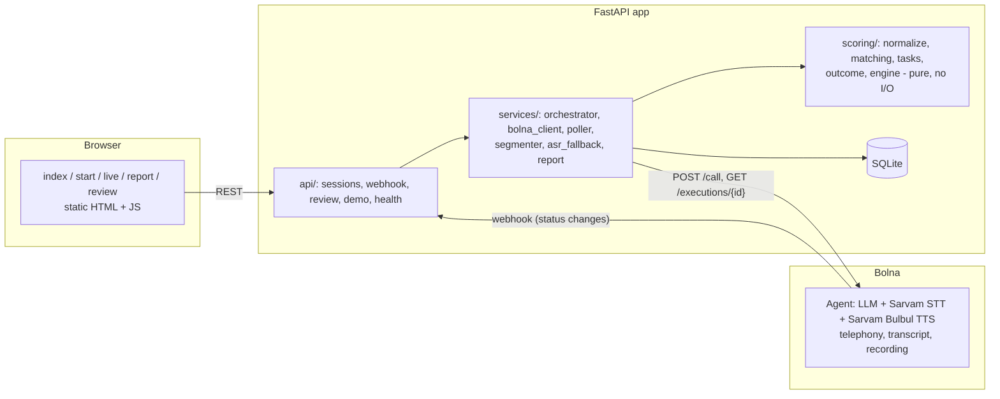

# Smriti: a 5-minute phone memory check in Indian languages

**Smriti calls an older person, runs a short, friendly memory check by voice in Hindi or English, and gives the family a clear report: Normal / Uncertain - retest / Refer to clinician / Invalid call. It never diagnoses. Every uncertain, refer or invalid result goes to a human reviewer.**

Built on [Bolna](https://bolna.ai) for the Bolna Voice AI Buildathon 2026. Inspired by the 10/66 Dementia Research Group battery, which was designed to be fair to people with little or no schooling.

> **Pilot, not validated, never diagnoses.** All cutoffs are placeholders in [`config/scoring.yaml`](config/scoring.yaml). See [ethics and limits](docs/ethics_and_limits.md).

---

## Try it

| | |
|---|---|
| Hosted demo | _NEXT: deploy link goes here (see checklist below)_ |
| Call me (live agent) | _NEXT: number goes here once Bolna credits arrive_ |
| Offline, on your laptop | 2 minutes, no keys: see the quickstart below |

The offline demo runs the **real scoring engine** on four realistic Hinglish calls (made-up, no real people) and lets you simulate a full call: Start → Live → Report → Reviewer queue.

## Offline quickstart (Windows or Linux/macOS, zero keys)

Requires Python 3.12.

```bash
python -m venv .venv
.venv\Scripts\activate          # Linux/macOS: source .venv/bin/activate
pip install -r requirements.txt
copy .env.example .env          # Linux/macOS: cp .env.example .env   (DEMO_MODE=1 by default)
uvicorn app.main:app --reload
```

Open <http://localhost:8000>:

- **Sample reports:** `/report.html?id=demo-normal`, `demo-uncertain`, `demo-refer`, `demo-invalid-hearing`
- **Simulate a call:** Start a memory check → tick consent → pick a demo conversation → watch the Live page → Report
- **Reviewer queue:** `/review.html`, token `change-me` (from `.env.example`)
- **API docs:** `/docs`

Run the tests (all Bolna calls are mocked with respx):

```bash
pip install -r requirements-dev.txt
pytest
```

Shortcuts: `.\tasks.ps1 setup|demo|test|create-agent|check|call` on Windows, `make setup|demo|test|create-agent|check|call` on Linux/macOS.

## How it works



1. A family member or clinic opens **Start**, gives consent, picks the language and enters the phone number.
2. The server calls `POST /call` on Bolna with `user_data = {session_id, word_form, language, word_list}`; the agent prompt receives the word list through `{{word_list}}`.
3. The agent asks for consent again on the call, then runs 6 short tasks, saying a **fixed marker phrase** at the start of each one ("पहला काम" / "Task one" …).
4. When Bolna reports the call finished (webhook, or the poller when we have no public URL), the server **re-fetches** `GET /executions/{id}`, splits the transcript into tasks by the marker phrases, and scores it with deterministic rules.
5. The **Report** shows the outcome, the rule that fired, and the evidence for every score. UNCERTAIN, REFER and INVALID go to the **Reviewer queue**.

More detail: [docs/architecture.md](docs/architecture.md) (flows and state machine).

## The memory check (≈5 minutes)

| # | Task | Score |
|---|---|---|
| 0 | Greeting + consent ("a memory check, not a medical test"; recorded) | no → call ends, `declined` |
| 1 | Hearing/line check: repeat 3 number strings (4-7-2, 3-9-5, 8-1-6), one slower retry | < 2/3 → **INVALID** |
| 2 | Years of schooling | LOW (≤ 10, incl. none) / HIGH (> 10) |
| 3 | 10-word list, 3 learning trials (forms A/B/C rotate; familiar, non-animal words) | 0–30 |
| 4 | Name as many animals as you can in one minute (synonyms count once: kutta = dog) | count |
| 5 | Orientation: day, month (traditional months accepted), season, time of day, town/village | 0–5 |
| 6 | Delayed recall of the 10 words | 0–10 |
| 7 | "Was anyone helping you answer?" + thanks, "this is not a diagnosis" | yes → **INVALID** |

**Outcome rules** (pilot placeholders, [`config/scoring.yaml`](config/scoring.yaml)); DR = delayed recall, F = animals, O = orientation:

| Band | REFER | UNCERTAIN | NORMAL |
|---|---|---|---|
| LOW (≤ 10 yrs) | DR ≤ 2 | DR = 3, or DR ≥ 4 with F < 8 **and** O ≤ 3 | DR ≥ 4 otherwise |
| HIGH (> 10 yrs) | DR ≤ 3 | DR = 4, or DR ≥ 5 with F < 11 **and** O ≤ 3 | DR ≥ 5 otherwise |

**INVALID** if: hearing check failed · call ended before delayed recall · > 30% of the 14 expected answers empty or unintelligible · someone was helping · the call was stopped for distress.

Scoring is **deterministic and explainable**: Devanagari → Latin transliteration, phonetic keys, rapidfuzz ratio ≥ 85 against the word list (Devanagari, Latin spellings and English all accepted). No LLM decides any score. Speech features (filler rate, words per answer) are shown as *experimental* and never affect the outcome. Full spec with worked examples: [docs/scoring_spec.md](docs/scoring_spec.md).

## Bolna features used

| Feature | Where |
|---|---|
| Agent API v2 (`POST /v2/agent`, `PUT /v2/agent/{id}`) built from [`config/agent.json`](config/agent.json) + [`prompts/smriti_agent.md`](prompts/smriti_agent.md) | [`scripts/create_agent.py`](scripts/create_agent.py) |
| Outbound calls (`POST /call`) with **`user_data` dynamic variables** (`{{word_list}}`, `{{language}}`): one agent serves all 3 word forms | [`app/services/orchestrator.py`](app/services/orchestrator.py) |
| Executions (`GET /executions/{id}`): status, transcript, `telephony_data.recording_url` | [`app/services/bolna_client.py`](app/services/bolna_client.py) |
| **Webhooks** (`agent_config.webhook_url`, token-checked) + a polling fallback | [`app/api/webhook.py`](app/api/webhook.py), [`app/services/poller.py`](app/services/poller.py) |
| Account info (`GET /user/me`: wallet, concurrency) | [`scripts/check_live.py`](scripts/check_live.py) |
| Indian-language voice stack: **Sarvam Saaras v4** STT (`hi`), **Sarvam Bulbul v3** TTS, GPT-4.1-mini LLM, Plivo telephony | [`config/agent.json`](config/agent.json) |
| Call controls: `hangup_after_silence` raised to 25 s for the 1-minute animal task, `call_terminate` = `MAX_CALL_MINUTES` | [`app/services/agent_builder.py`](app/services/agent_builder.py) |
| Web Call SDK (`@bolna/web-call`, backend-minted `POST /web-call/session`) - optional | [`app/web/webcall.js`](app/web/webcall.js) |

## Live setup (when you have Bolna credits)

1. Put `BOLNA_API_KEY` in `.env` (platform.bolna.ai → Developers → API Keys).
2. Review the agent without spending anything: `python scripts/create_agent.py --dry-run`
3. Create it: `python scripts/create_agent.py` → copy the printed id into `.env` as `BOLNA_AGENT_ID`.
4. `python scripts/check_live.py` → prints wallet balance, concurrency, confirms the agent exists, and says **READY** or what is missing.
5. Set `DEMO_MODE=0`. Call your own phone end to end: `python scripts/test_call.py +91XXXXXXXXXX`
6. For webhooks, `PUBLIC_BASE_URL` must be a public https URL (deploy, or `cloudflared tunnel --url http://localhost:8000`), then `python scripts/create_agent.py --update`. Without it the poller fetches results every 10 s.

In live mode the app refuses to start without `BOLNA_API_KEY` and `BOLNA_AGENT_ID`, or with the example `change-me` secrets, with a message saying what to set. Generate secrets with `python -c "import secrets; print(secrets.token_urlsafe(24))"`.

### NEXT (needs credits)

Everything below is implemented and tested against mocks; it is only waiting on keys.

- [ ] Fill `.env` → `check_live.py` → `create_agent.py` → `test_call.py` to my phone
- [ ] Read the first real transcript; adjust `segmenter.py`/marker phrases if Bolna's transcript format or the LLM's wording differs from the fixtures
- [ ] Confirm the `TODO(bolna)` items below with a real call
- [ ] Tune the Hindi tasks with a few web calls; mini pilot with 5–10 elders, logged in [docs/pilot_log.md](docs/pilot_log.md)
- [ ] Deploy with `DEMO_MODE=0` (Render blueprint in [`render.yaml`](render.yaml)), set `PUBLIC_BASE_URL`, `create_agent.py --update` to register the webhook, update "Try it" above
- [ ] Optional: web call in the browser

### TODO(bolna): things the docs do not settle

| Question | Where it matters | Fallback in code |
|---|---|---|
| Is the Web Call session's `run_id` the execution id for `GET /executions/{id}`? | `orchestrator.create_session` (web mode) | webhook also matches by `session_id` in user data |
| Where is `user_data` echoed back in executions/webhooks (`context_details.recipient_data`?) | `api/webhook.py` | match by `execution_id` (phone calls always have it) |
| Format of `transcriber.keywords` for Sarvam (biasing the 30 list words) | `agent_builder.py` | off unless `--with-keywords` |
| Is `telephony_data.recording_url` fetchable by a third party (Deepgram) without auth? | `asr_fallback.py` | fluency counted over the whole segment |
| Do English calls sound right with the Sarvam `hi` STT + Bulbul voice, or do we need a second agent? | `config/agent.json` | Hinglish is the main path |
| Webhook retries / signing (not documented) | `api/webhook.py` | token in the URL + always re-fetch + poller |
| `gpt-4.1-mini` is listed as previous-generation on Bolna's OpenAI page | `config/agent.json` | switch to `gpt-5.4-mini` (requires `temperature: 1`) if creation fails |
| Is 8 minutes (`MAX_CALL_MINUTES`) enough for slower speakers? | `.env` | raise to 10 after the first real calls |

## Repository layout

```
app/
  main.py            app factory, static UI, startup: DB, demo seed, poller
  settings.py        all settings from .env (pydantic-settings)
  models.py db.py    SQLite tables: Session, CallArtifact, Score, Review
  api/               thin routes: sessions, webhook, review, demo, health
  services/          I/O: bolna_client, orchestrator, poller, segmenter, asr_fallback, report
  scoring/           pure functions: normalize, matching, tasks, outcome, engine
  web/               static pages + i18n (hi/en)
config/              scoring.yaml, wordlists.yaml, animals.yaml, agent.json
prompts/             smriti_agent.md (voice agent script with marker phrases)
scripts/             create_agent, check_live, test_call, seed_demo
fixtures/            4 Hinglish calls: normal, uncertain, refer, invalid_hearing
tests/               scoring, API, Bolna client (respx)
docs/                architecture, scoring spec, ethics, pilot log, deck notes
```

## Privacy and safety

- Consent twice: a checkbox in the UI **and** a spoken yes at the start of the call. No → nothing is scored.
- Phone numbers are used only to place the call; we store a salted hash and the last 4 digits. Logs carry `session_id`/`execution_id` only; numbers are redacted.
- Data lives only in the app's SQLite file. `DELETE /api/sessions/{id}` (the "Delete this data" button) wipes the transcript, recording link and scores.
- The agent never says "dementia", never diagnoses, never hints or corrects. If the person sounds distressed it stops, reassures, and the session is marked `stopped`. A helpline is shown only if `HELPLINE_TEXT` is set to a verified number.
- Hosted demo: daily call limits per IP (`MAX_CALLS_PER_IP_PER_DAY`), per phone number and per deployment, max call length (`MAX_CALL_MINUTES`), reviewer pages behind `ADMIN_REVIEW_TOKEN`. In live mode the app **refuses to start** while `SECRET_SALT`, `ADMIN_REVIEW_TOKEN` or `BOLNA_WEBHOOK_TOKEN` still say `change-me`.
- A webhook and the poller can both report the same call; an atomic claim makes sure it is scored exactly once. `POST /call` is never retried after a timeout, so nobody is dialled twice.
- SQLite on free hosting tiers may reset on redeploy (fine for a demo); attach a volume and point `DATABASE_URL` at it for persistence.

## Limitations

- **Not validated.** Word lists, cutoffs and the animal lexicon are pilot placeholders; they need local normative data and clinical validation before any real use.
- Speech recognition of older voices, regional accents and noisy lines will cause misses; fuzzy matching helps but cannot fix everything. INVALID exists to catch bad calls, and humans review the rest.
- The animal-naming minute is not timed precisely: Bolna's transcript has no per-turn timestamps, so we count the whole segment (`experimental_timing: true`) unless the optional Deepgram pass over the recording is enabled.
- The town/village answer is accepted if given; it cannot be verified automatically.
- Only Hindi and English for now.

## Roadmap

1. Pilot with 5–10 elders and caregivers ([template](docs/pilot_log.md)); measure completion rate, call length, how non-readers did.
2. Clinical validation with a memory clinic: compare against a clinician assessment, derive education-adjusted cutoffs.
3. More languages (Marathi, Bengali, Tamil, Telugu…): new word lists + lexicons, same engine.
4. Regulatory path: as a screening aid this is likely Software as a Medical Device under India's Medical Devices Rules 2017 (CDSCO); plan for that before any clinical claim. Personal data under the DPDP Act 2023.
5. Caregiver follow-up calls, retest reminders, clinic dashboards.

## License

MIT. See [LICENSE](LICENSE).
