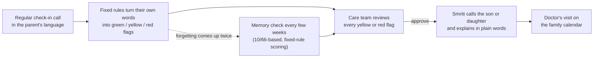
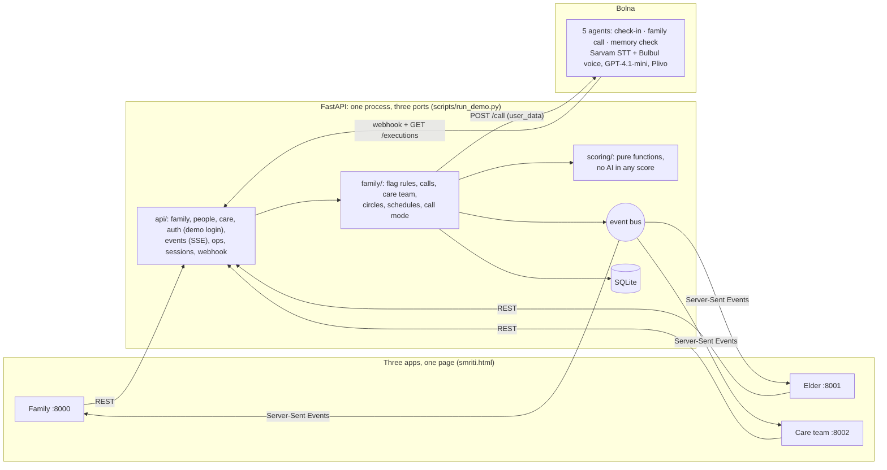

# Smriti · स्मृति · ಸ್ಮೃತಿ

### Every week, someone remembers.

**Smriti is an AI voice companion that phones older parents in their own language, listens the way a caring nurse would, remembers what they said, and makes sure the family acts when something matters.** A short, structured memory check runs every few weeks as part of those regular check-ins. Smriti never diagnoses: a person on the care team reviews every concern before the family is called.

Built on **[Bolna](https://bolna.ai)** for the Bolna Voice AI Buildathon 2026 by **Team Epoch Zero**.

> **A pilot, not a medical device.** Smriti never diagnoses, and its memory-check cut-offs are placeholders that still need clinical validation. See [ethics and limits](docs/ethics_and_limits.md).

---

## Contents

[The problem](#the-problem) · [What Smriti does](#what-smriti-does) · [Why it's different](#why-its-different) · [Demo in 5 minutes](#demo-in-5-minutes) · [Features](#features) · [Inside a call](#inside-a-call) · [Architecture](#architecture) · [Tech stack](#tech-stack) · [Built on Bolna](#built-on-bolna) · [Languages](#languages) · [Privacy and safety](#privacy-consent-and-safety) · [Run it yourself](#run-it-yourself) · [What real calls taught us](#what-real-calls-taught-us) · [Limitations](#honest-limitations) · [Roadmap](#roadmap) · [Repository](#repository-layout)

---

## The problem

We call home and hear **"all fine."** Children who live in another city can't tell how their parents are really doing. Changes in memory, mood, sleep, pain and loneliness build up quietly, and families often find out late, after a fall or a hospital visit.

- About **7.4% of Indians aged 60+, roughly 8.8 million people, have dementia** (LASI-DAD, *Alzheimer's & Dementia*, 2023).
- India's 60+ population share goes from **10.1% (2021) to 15% (2036) to 20.8% (2050)** (UNFPA India Ageing Report 2023). Southern states, Karnataka included, are ageing faster than the national average.
- **9% of older women and 2.6% of older men live alone** (LASI Wave 1).
- Memory is the change a family is least likely to hear on a phone call, and a memory check needs someone to sit with the person, in a language they're comfortable in.

## What Smriti does



1. **Check-ins:** Smriti calls the parent at the times the family sets, in any of 11 Indian languages. She asks how they really are, follows up on last time once, and asks the family's own questions ("Did you take your BP tablet?").
2. **Flags:** after the call, fixed rules turn the parent's own words into flags, e.g. *"poor sleep came up in 2 calls this month."* The AI holds the conversation; it never decides a flag or a score.
3. **Memory check:** every few weeks (every 4 weeks by default), or sooner if forgetting keeps coming up, Smriti runs a 5-minute structured memory check based on the 10/66 Dementia Research Group battery, which was designed to be fair to people with little or no schooling.
4. **Care team:** a person reviews every concern, with the transcript and the rule that fired.
5. **Family:** on approval, Smriti phones the son or daughter, explains in plain words, says clearly that this is not a diagnosis, and offers to put a doctor's visit on their calendar.

**One sentence:** *Smriti is the friend who calls your parents every week, remembers what they said, and makes sure the family acts when something matters.*

## Why it's different

| | Automated reminder calls | Remote-monitoring apps | **Smriti** |
|---|---|---|---|
| Needs a smartphone or device | No | Yes | **No: any phone** |
| Talks in the parent's language and lets them switch mid-call | Rarely | No | **11 Indian languages, mixed Hinglish/Kanglish welcome** |
| A real conversation that remembers last time | No, recordings | No | **Yes** |
| Structured memory check | No | No | **Yes, fixed-rule scoring, item by item** |
| A person reviews before the family is worried | No | Sometimes | **Always** |
| Ends with the family acting (call + doctor's visit) | No | Alerts only | **Yes** |
| The elder controls what is shared | No | Rarely | **Yes, and their "no" is final** |

## Demo in 5 minutes

One command sets everything up and serves **three apps on three ports**, all live-synced: anything done in one app shows up in the others within a second. No keys needed (calls are simulated). Needs Python 3.11+.

```bash
python start.py --open        # first run: makes .venv, installs packages, creates .env, opens the three apps
```

`python start.py --reset` gives a fresh sample family (Appa, Ravi, Priya, Dr. Meera) before starting. No Python? `docker compose up --build`, then open the same three addresses.

| Open | Log in as (demo button, no password) | Try this |
|---|---|---|
| **http://localhost:8000/smriti.html** (Family) | Ravi Rao | Today → **Call Appa now** (watch the live call panel) → the new entry slides into the timeline. Or **+ Add a parent** and call them in English or Hindi. |
| **http://localhost:8001** (Elder) | Raghunath Rao (Appa) | Say **yes** to Priya joining. Ravi's history updates live. Change the language, what's shared, or pause calls. |
| **http://localhost:8002** (Care team) | Dr. Meera Iyer | Review queue → Appa's memory check (REFER) → **Approve and call Ravi** → a memory-clinic visit appears on the family calendar. |

- **Real calls switch:** in the sidebar of every app. It's **off by default**, so calls are simulated end to end and no Bolna credits are spent. Turning it on asks first and shows the wallet balance.
- **Full demo script:** [docs/DEMO_PLAN.md](docs/DEMO_PLAN.md).
- **Hard questions and answers:** [docs/DEMO_QA.md](docs/DEMO_QA.md).

## Features

**For the elder (port 8001)**
- **Big text, three screen languages:** English · हिंदी · ಕನ್ನಡ. The page opens in the parent's own language.
- **"Call me now":** a short chat on demand.
- **They're in control:**
  - choose what the family can see: *only that I'm okay*, *health worries too*, or *everything*;
  - choose the call language;
  - **pause all calls**;
  - **say yes or no to anyone who wants to join**.
- **A Smriti ID with a QR code.**
- **"Smriti will never ask you for money, bank details or an OTP."** Shown on the page and said on the calls.

**For the family (port 8000)**
- **Today:** the parent's latest mood, this week's flags in their own words (with an English translation), the message they asked Smriti to pass on, and what's coming up.
- **Timeline ("the thread"):** every call is a point on one thread, coloured only when something needs attention, and it shows what Smriti remembered from last time.
- **Calendar:** past and planned calls, the memory-check due date and doctor's visits, with **Add to Google Calendar** and an **.ics** download.
- **Memory:** the latest result in plain words, past results, what it means and doesn't mean, and a "Start a memory check" button.
- **Reports:** mood across 8 weeks, what came up, how many calls were completed, and a **printable one-page doctor summary** (only if the parent allows sharing).
- **Schedules:** "every day at 8 pm, ask: *did you take your BP tablet?*", with **Run now**.
- **Family circle:** members, invites by phone number or **Smriti ID**, and contacts that connect when both people add each other.
- **Names Smriti uses:** set your own name, the parent's name, what you call them ("Amma") and how Smriti greets them ("Kamala ji"). Smriti says these on every call, for example "Is there anything you'd like me to tell Prem?"
- **+ Add a parent:** name, age, city, preferred language (11), relation and sharing level. They get their own elder login. Switch between parents from the sidebar.
- **History:** everything that happened in the circle, live.

**For the care team (port 8002)**
- **Patients:** the people whose families shared with this clinic, with the parent's agreement.
- **Review queue:** red first, then memory checks, then yellow. Each case shows the parent's words, the rule that fired, the transcript and the recording.
- **Approve and call the family:** pick the language (English, Hindi or Kannada). Smriti explains, offers a visit, and the visit lands on the family calendar.
- **Patient page:** memory-check results item by item (word learning, delayed recall, animal naming, orientation), what came up over 8 weeks, and the timeline. **Order a memory check** from here.
- **Behind the call:** cost and length of every call and the wallet balance, all from Bolna.

**Across all three**
- **Demo login and logout,** with a separate login per port so all three apps can be open side by side.
- **Live sync** over Server-Sent Events, with a polling fallback.
- **Real calls / simulated calls switch,** shared by all three apps.
- **Language for every call:** the parent's preferred language, any of 11 for that call only, or **"Let them choose"** (Smriti opens in English and asks).

## Inside a call

### The check-in (about 3 minutes)

| Step | What Smriti does |
|---|---|
| Open | "Hello! This is Smriti, your family's AI companion, calling to check in on you. Is this a good time?" |
| Trust | "As always, I will never ask you for money, bank details or an OTP." |
| Listen | "How are you feeling today? Has anything new been bothering you?" She answers what they said first and keeps turns to one or two sentences. |
| Care | She gently covers sleep, appetite, energy, mood, getting out and medicines, with one follow-up question per problem. She never advises, names an illness or says "it's nothing". |
| Family | She asks the family's own questions, and follows up on last time once and never again. |
| Close | "Is there anything you'd like me to tell Ravi?" Then she says exactly what will be shared, and says goodbye. |
| Emergency | Chest pain, a fall, breathlessness or not wanting to live: "Please call 112 now. I'm also letting our care team know." Abuse: the Elder Line, 14567, and the family is never told. |

After the call, **[fixed rules](config/flags.yaml)** turn mentions into flags:
- **Red:** chest pain, a fall, breathlessness, confusion, not wanting to live, safety worries.
- **Yellow:** loneliness or missed medicines; pain, poor sleep, appetite, low mood or forgetting when it comes up twice within 30 days.
- **Green:** mentioned once, noted only.

The rules handle negation ("no pain") and improvement ("my knee is better").

### The memory check (about 5 minutes)

| # | Task | Score |
|---|---|---|
| 0 | Greeting and consent ("a memory check, not a medical test"; recorded) | no → call ends, `declined` |
| 1 | Hearing and line check: repeat 3 number strings, with one slower retry | below 2/3 → **INVALID** |
| 2 | Years of schooling | LOW (10 or fewer, including none) / HIGH (more than 10) |
| 3 | 10-word list, 3 learning trials (word forms A, B and C rotate) | 0–30 |
| 4 | Name as many animals as you can in one minute | count |
| 5 | Orientation: day, month (traditional months accepted), season, time of day, town | 0–5 |
| 6 | Delayed recall of the 10 words | 0–10 |
| 7 | "Was anyone helping you answer?" | yes → **INVALID** |

**How the outcome is decided** (the thresholds are placeholders, set in [`config/scoring.yaml`](config/scoring.yaml)):
- **Possible outcomes:** NORMAL, UNCERTAIN (retest), REFER (see a doctor) and INVALID.
- **Inputs:** delayed recall, animal count and orientation, adjusted for schooling band.
- **INVALID if:**
  - the hearing check failed;
  - the call ended early;
  - more than 30% of answers were empty;
  - someone was helping;
  - the person was distressed.

**How answers are matched:**
- Devanagari and Kannada are transliterated to Latin, then matched by sound with strict fuzzy rules.
- An answer in one script only matches the word list's spellings in that same script.
- English words spoken in Indic script count ("हाउस", "ಡಾಗ್").
- **No AI decides any score.**

Worked examples are in [docs/scoring_spec.md](docs/scoring_spec.md).

## Architecture



1. A call button sends `POST /call` with `user_data`: the parent's name, notes from last time, India topic cards, the family's questions, the exact sharing sentence and the starting language.
2. The call ends. Bolna's webhook arrives (or the poller picks it up), and the server **re-fetches** the execution.
3. An **atomic claim** makes sure each call is processed exactly once.
4. Check-ins go through the flag rules; memory checks are split into tasks by fixed marker phrases and scored.
5. Every change is published on the event bus, so all three apps update.

More detail: [docs/architecture.md](docs/architecture.md).

## Tech stack

| Layer | Choice |
|---|---|
| Voice | **Bolna** orchestration · **Sarvam Saaras v4** speech-to-text · **Sarvam Bulbul v3** voice ("Suhani", one voice for all 11 languages) · **GPT-4.1-mini** (temperature 0.2) · **Plivo** telephony |
| Backend | Python 3.12 · **FastAPI** · **SQLModel** / SQLAlchemy on **SQLite** · pydantic-settings · httpx (async Bolna client) · uvicorn (one process on three ports) |
| Scoring and flags | Pure Python rules · **indic-transliteration** (Devanagari and Kannada to Latin) · **rapidfuzz** · YAML rule files · no AI in any score or flag |
| Live updates | Server-Sent Events from an in-process event bus, with a polling fallback |
| Frontend | Vanilla JavaScript and CSS, no build step · one page for three apps · **Atkinson Hyperlegible** (made for low-vision readers), **Fraunces**, **Noto Sans Devanagari and Kannada** · qrcode.js |
| Design | Calm and readable: porcelain background, peacock teal, marigold for warmth, colour only for meaning, 18 px body text and above, 48 px touch targets |
| Quality | **pytest** (328 tests; Bolna always mocked with **respx**) · **ruff** |

## Built on Bolna

| Bolna feature | How Smriti uses it |
|---|---|
| Agent API v2 (`POST /v2/agent`, `PUT /v2/agent/{id}`) | Five agents built from [`config/agent.json`](config/agent.json) and [`prompts/`](prompts/) by [`scripts/create_agent.py`](scripts/create_agent.py) (`--kind checkin \| family`, `--multilingual`, `--language`) |
| **Multilingual agents** (`multilingual_config`) | The check-in agent speaks 11 languages and switches when asked or when the person changes language. The memory check uses `caller_requested`, so a few English words never flip the language mid-test. |
| Per-call start language (`user_data.agent_language`) | Preferred language, a one-call override, or "Let them choose" |
| **Dynamic variables** in `user_data` | Notes from last time, India topic cards (festivals, family), the family's questions, the sharing sentence, the word lists |
| Turn-taking for elderly callers | `number_of_words_for_interruption: 2`, transcriber `endpointing: 500`, `noise_cancellation_level: 85`, `check_user_online_message` in the call's language, `hangup_after_silence` |
| Clean endings | `hangup_after_LLMCall` with a hang-up prompt, so the call ends after the goodbye and only then |
| "Call me later" | `auto_reschedule` (beta) on the check-in agent |
| Results | Webhooks plus `GET /executions/{id}`: transcript, recording, `total_cost`, duration |
| Account | `GET /user/me`: wallet balance, shown next to the real-calls switch |

## Languages

| Where | Languages |
|---|---|
| **Check-in calls** | English, हिंदी, ಕನ್ನಡ, தமிழ், తెలుగు, മലയാളം, मराठी, বাংলা, ગુજરાતી, ਪੰਜਾਬੀ, ଓଡ଼ିଆ (11). The person decides and can switch mid-call. |
| **Memory check** | Hindi, Kannada, English (word lists and scoring exist for these). It opens in English, asks, then keeps that language. |
| **Call to the family** | English, Hindi, Kannada |
| **Flag rules** | Hindi, Kannada, English, including Hinglish and Kanglish |
| **Screens** | English, हिंदी, ಕನ್ನಡ |

## Privacy, consent and safety

- **The parent owns it.** They agree on the call, choose what is shared, can pause everything, and approve who joins. Their "no" is final.
- **No diagnosis, ever.** Smriti says "worth seeing a doctor", never "dementia". A person reviews every concern before the family is called.
- **Safety concerns stay with the care team.** If the parent says someone is hurting them or taking their money, the family is never told. The care team uses the Elder Line, 14567.
- **Phone numbers are never stored in plain text.** The server keeps a salted hash and the last 4 digits; numbers typed in the app stay in that browser.
- **No surprise calls or spending.** Real calls are off until someone turns them on, and turning them on asks first. Scheduled calls never dial on their own in live mode.
- **Exactly once.** The webhook and the poller can both report a call; an atomic claim processes it once. `POST /call` is never retried after a timeout, so nobody is dialled twice.
- **Locked down by default.** In live mode the app refuses to start with example secrets. Every family and care-team API checks circle membership and role.

## Run it yourself

**Offline, with no keys: one command (Windows, macOS, Linux; Python 3.11+):**

```bash
git clone https://github.com/rkprem0518-gif/Smrithi.git
cd Smrithi
python start.py --open
```

`start.py` creates `.venv`, installs the packages, copies `.env.example` to `.env` (offline mode), and starts the three apps:

| App | Address | Log in as |
|---|---|---|
| Family | http://localhost:8000/smriti.html | Ravi Rao or Priya Rao |
| Elder | http://localhost:8001/smriti.html | Raghunath Rao (Appa) |
| Care team | http://localhost:8002/smriti.html | Dr. Meera Iyer |

- **Stop:** Ctrl+C. **Start again:** `python start.py`. **Fresh sample family:** `python start.py --reset`.
- **Ports busy?** It says which ones. Close the other window, or set `FAMILY_PORT`, `ELDER_PORT` and `CLINIC_PORT` in `.env`.
- **No Python?** Run `docker compose up --build` and open the same addresses.
- **Tests:** `.venv/Scripts/python -m pip install -r requirements-dev.txt`, then `.venv/Scripts/python -m pytest`. On macOS/Linux use `.venv/bin/python`. Bolna is always mocked in the tests.

**Hosting:** Smriti needs a server that keeps running (live updates between the apps, the job that fetches call results, a database file), so serverless hosts like Vercel don't fit. A container host such as Render, Railway or Fly works. [`render.yaml`](render.yaml) deploys the family app; serving all three apps from one public address is on the roadmap.

**Live, with Bolna:**
1. Put `BOLNA_API_KEY` in `.env`, then set `DEMO_MODE=0` and long random values for `SECRET_SALT`, `ADMIN_REVIEW_TOKEN` and `BOLNA_WEBHOOK_TOKEN`.
2. Create the agents. Creating or updating an agent places no calls and spends no credits.
   ```bash
   python scripts/create_agent.py --multilingual          # memory check  -> BOLNA_AGENT_ID (+ BOLNA_MULTILINGUAL=1)
   python scripts/create_agent.py --kind checkin          # check-in      -> BOLNA_AGENT_ID_CHECKIN
   python scripts/create_agent.py --kind family           # family call   -> BOLNA_AGENT_ID_FAMILY
   ```
   Add `--dry-run` to see the payload first, or `--update` to push changes to an existing agent.
3. Check the account and agents: `python scripts/check_live.py`
4. Run `python scripts/run_demo.py`, then switch **Real calls** on in any app.
5. **Trial accounts** can only call numbers verified in the Bolna dashboard (User Profile → Verified Numbers).
6. **Webhooks:** set `PUBLIC_BASE_URL` to a public https URL (a deploy or a tunnel), then run `create_agent.py --update`. Without it, the poller fetches results every 10 seconds.

## What real calls taught us

Every row below came from a real call on Bolna and was fixed.

| What happened | What we changed |
|---|---|
| Bolna's "are you still there?" fired in English on a Hindi call | That message is now in the call's language, and every greeting ends with a question |
| A Kannada call hung up after 25 s, before the first transcript arrived | Silence timeout of 40 s, and the localised online check fires at 12 s |
| Noisy call from a moving car: hearing check 0/3 | Correctly marked **INVALID**, meaning "retest on a clearer line", not a misleading score. Noise cancellation turned on |
| A number retry and the next string were said in one breath | One number string per message, then wait |
| The call didn't end after the goodbye | Hang up using a prompt, right after the final goodbye |
| "Second year" (college) read as 2 years of school | "Nth year" now counts as 12 + n |
| English words came out in native script ("यस", "ಡಾಗ್") | Hinglish and Kanglish are accepted throughout |
| "That's all" during animal naming triggered the distress stop | Stops only on clear distress; otherwise "Shall we continue?" |
| The check-in kept talking when the person spoke | Interrupts after 2 words, 500 ms endpointing, short turns |
| It kept asking about the same knee | Notes are used once, then retired; open nurse-style questions |
| It ignored "ಯಾವುದು?" ("which one?") | "Listen first": answer what they said before anything new |
| It promised to share less than the parent had chosen | The server now sends the exact sharing sentence |
| The person said "Sure" in English but the call stayed in the family's language | The person's own language wins; locked once the memory check starts |

Each fix is in the git history; the pilot will be logged in [docs/pilot_log.md](docs/pilot_log.md).

## Honest limitations

- **Not validated.**
  - Memory-check cut-offs and word lists are pilot placeholders.
  - Phone administration hasn't been compared with a clinician's assessment yet. That's the first pilot.
  - No combined score across health checks is validated, so Smriti doesn't make one.
- **Speech recognition:**
  - Older voices, accents and noisy lines cause misses; INVALID and human review catch them.
  - Flag rules cover Hindi, Kannada and English; for the other 8 call languages the care team reads the transcript.
  - Fixed rules miss things nobody wrote a rule for (e.g. "the doctor put a rod in").
- **Not yet production-ready:**
  - Demo login has no passwords; real accounts need phone and OTP.
  - Scheduled calls only dial by themselves in demo mode, until an encrypted number store exists.
  - Bolna trial accounts can only call verified numbers, and there is no API to verify one from the app.
  - The Tamil, Telugu, Malayalam, Marathi, Bengali, Gujarati, Punjabi and Odia greetings, and the Hindi and Kannada screen text, need native-speaker review.

## Roadmap: from a memory check to a care platform

**Today, live on Bolna:** check-ins in 11 languages, the memory check, a care team, and the call to the family.

**Next: three features families can picture**

| Feature | What it does | How it stays safe |
|---|---|---|
| **Build your own check-in** | A family member types "Appa has diabetes and BP". An AI suggests questions (*"Did you check your sugar today? What was the number? Any dizziness?"*) and safe limits for readings. The family edits and approves them, and Smriti asks on schedule. | The AI only suggests; the family approves; the care team can review a check-in before it runs. Readings are flagged by fixed limits the family or doctor set. Smriti never advises. |
| **More health checks like the memory check** | Each in its own announced call: mood (PHQ-9 / GDS-15), falls (CDC STEADI questions), loneliness (UCLA-3), frailty (FRAIL), and the family's own observations (10/66 informant questions). | Free or public-domain tools only, scored by fixed rules and reviewed by a person. No combined score across checks. |
| **Family voice notes** | The son records a real ten-second message, *"Hi Appa, talk to Smriti, I'll hear how you are"*, which opens the call. Replies carry both ways. | A real recording, never a cloned voice. Cloned family voices are a common scam against elders, and Smriti always says it is an AI. |

**Beyond**
- **Pilot:** 20–30 families in Bengaluru. We measure whether parents pick up week after week and whether families act on flags.
- **Validation** with a memory clinic: compare against clinician assessment, and set cut-offs adjusted for years of schooling.
- **Partners:** elder-care companies whose care managers become the care team, employer parent-care benefits and insurers, running Smriti for thousands of elders.
- **More from Bolna:**
  - post-call extraction as *suggestions* for the care team;
  - Cal.com booking during the family call;
  - batch scheduling with calling hours;
  - Truecaller caller ID;
  - India data residency.
- **Regulation:**
  - DPDP Act consent flows.
  - A regulatory opinion before any screening claim: software as a medical device under India's Medical Devices Rules, overseen by CDSCO.

## Repository layout

```
app/
  main.py              app factory, startup: database, sample family, poller, scheduler
  api/                 family + people + care + auth (demo login, live SSE, call mode), events, ops,
                       sessions, webhook, review
  family/              flag rules, calls (start/finish/simulate), care team, timeline, calendar, reports,
                       people (logins, contacts, circles, schedules, history), auth, callmode, scheduler, seed
  services/            Bolna client, orchestrator, poller, segmenter, report, event bus, ops
  scoring/             pure functions: normalize, matching, tasks, outcome, engine
  web/                 smriti.html + smriti.js / smriti-apps.js / smriti-i18n.js / smriti.css (the 3 apps);
                       index / start / live / report / review (the original memory-check pages)
config/                agent.json (5 agents), flags.yaml, playbook.yaml (India topic cards),
                       scoring.yaml, wordlists.yaml, animals.yaml
prompts/               checkin_agent.md, family_agent.md, smriti_agent.md (memory check)
scripts/               run_demo (3 ports), seed_family, create_agent, check_live, test_call
fixtures/              5 sample memory-check calls (made up, no real people)
tests/                 328 tests: scoring, API, Bolna client, live updates, family product
docs/                  BLUEPRINT · DEMO_PLAN · DEMO_QA · architecture · scoring_spec · ethics_and_limits · pilot_log
```

## Team

**Epoch Zero** · built for the Bolna Voice AI Buildathon 2026.

## License

MIT. See [LICENSE](LICENSE).
