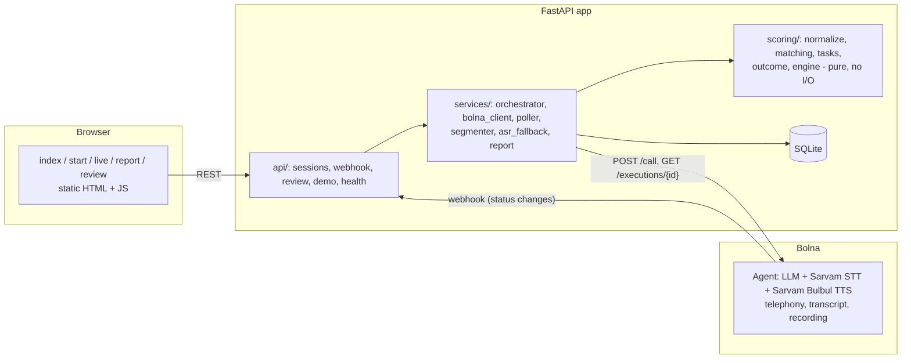

# Smriti: every week, someone remembers

**Smriti is an AI companion that phones older parents in their own language, listens like a caring nurse, remembers what they said, and makes sure the family acts when something matters. A short memory check, scored by fixed rules, runs every few months as part of those regular check-ins. It never diagnoses: a person on the care team reviews every concern before the family is called.**

Built on [Bolna](https://bolna.ai) for the Bolna Voice AI Buildathon 2026. The memory check is inspired by the 10/66 Dementia Research Group battery, which was designed to be fair to people with little or no schooling.

> **Pilot, not validated, never diagnoses.** All cutoffs are placeholders in [`config/scoring.yaml`](config/scoring.yaml). See [ethics and limits](docs/ethics_and_limits.md), the product [blueprint](docs/BLUEPRINT.md), the [demo plan](docs/DEMO_PLAN.md) and the [hard questions](docs/DEMO_QA.md).

---

## Try it

| | |
|---|---|
| Three apps on your laptop | `python scripts/run_demo.py`: family app on :8000, elder app on :8001, care-team app on :8002, live-synced (see below) |
| Live agents on Bolna | Five agents: weekly **check-in** (11 Indian languages), **call to the family**, and the **memory check** (multilingual, plus Kannada and English backups). Real calls have run end to end since 5 Nov 2026 (see *Live status*) |
| Offline, no keys | `DEMO_MODE=1`: every call is simulated through the same pipeline; Bolna is never contacted |

## The three apps

One server, three ports, one database. Anything done in one app (a call, a review, someone joining) appears in the others within a second, over Server-Sent Events.

| Port | Who | What they do |
|---|---|---|
| **:8000 Family** (`/smriti.html`) | Son, daughter, grandchild | Today, timeline ("the thread"), calendar (Add to Google Calendar, .ics), memory, reports and a printable doctor summary, **schedules** with their own questions ("Did you take your BP tablet?"), **family circle** (Smriti IDs with QR, contacts by phone or ID), history, **+ Add a parent**, parent switcher |
| **:8001 Elder** | The parent (owner of the circle) | Big-text page: say yes or no to new members, **call me now**, choose the call language, choose what the family can see, **pause all calls**, own Smriti ID |
| **:8002 Care team** | Clinic or care partner | Patients, **review queue** (red first), transcript and audio, approve → Smriti calls the family and offers a doctor's visit, order a memory check, call costs from Bolna |

- **Demo login:** pick a person, no password. Each port has its own login cookie, so all three can be open side by side.
- **Screen language:** English · हिंदी · ಕನ್ನಡ (the elder app opens in the parent's language).
- **Real calls switch** (sidebar of every app): off by default, so every call is simulated and **no Bolna credits are used**. Turning it on asks first and shows the wallet. The switch is shared by all three apps and can never turn on for an offline server.
- **Language of a call:** each parent has a preferred language (any of 11). Every call dialog can use it, pick another language for that call only, or **"Let them choose"** (Smriti opens in English and asks). People can also switch mid-call by asking.
- **Who decides what:** only the elder changes what is shared, their language, or pauses calls, and approves who joins. Only the care team sees the review queue. Safety concerns (e.g. someone hurting them) never go to the family.

### Run the demo

```bash
python scripts/seed_family.py --reset   # sample family: Appa (Kannada), Ravi, Priya (waiting to join), Dr. Meera
python scripts/run_demo.py              # family :8000 · elder :8001 · care team :8002
```

Ports come from `FAMILY_PORT`, `ELDER_PORT`, `CLINIC_PORT` in `.env`. **+ Add a parent** creates a fresh profile (with its own elder login) for a live demo; **Reset** removes every added profile and keeps the sample family.

### What a check-in call sounds like

Smriti greets them and asks if it's a good time, promises she will never ask for money, bank details or an OTP, then asks open questions like a good nurse: *"How are you feeling today? Has anything new been bothering you?"*, then gently covers sleep, appetite, energy, mood, getting out, medicines. She answers what they said first, keeps turns to one or two sentences, follows up on last time **once** (never the same topic twice), asks the family's own questions, and closes with *"Is there anything you'd like me to tell Ravi?"* and exactly what will be shared. Emergencies (chest pain, a fall, breathlessness) get *"Please call 112 now"*; abuse gets the Elder Line, 14567.

After the call, **fixed rules** ([`config/flags.yaml`](config/flags.yaml)) turn the parent's own words into green / yellow / red flags (e.g. "poor sleep came up in 2 calls this month"), the timeline updates, and anything yellow or red waits for the care team.

## Offline memory-check pages

The original memory-check pages still work: they run the **real scoring engine** on five realistic sample calls (four Hinglish, one Kannada; made-up, no real people) and let you simulate a full call: Start → Live → Report → Reviewer queue.

## Offline quickstart (Windows or Linux/macOS, zero keys)

Requires Python 3.12.

```bash
python -m venv .venv
.venv\Scripts\activate          # Linux/macOS: source .venv/bin/activate
pip install -r requirements.txt
copy .env.example .env          # Linux/macOS: cp .env.example .env   (DEMO_MODE=1 by default)
uvicorn app.main:app --reload
```

Open <http://localhost:8000>:

- **Sample reports:** `/report.html?id=demo-normal`, `demo-uncertain`, `demo-refer`, `demo-invalid-hearing`, `demo-kannada` (a full Kannada call)
- **Simulate a call:** Start a memory check → tick consent → pick a demo conversation → watch the Live page → Report
- **Reviewer queue:** `/review.html`, token `change-me` (from `.env.example`)
- **API docs:** `/docs`

Run the tests (all Bolna calls are mocked with respx):

```bash
pip install -r requirements-dev.txt
pytest
```

Shortcuts: `.\tasks.ps1 setup|demo|test|create-agent|check|call` on Windows, `make setup|demo|test|create-agent|check|call` on Linux/macOS.

## How it works



1. A family member or clinic opens **Start**, gives consent, picks the language and enters the phone number.
2. The server calls `POST /call` on Bolna with `user_data = {session_id, word_form, language, word_list}`; the agent prompt receives the word list through `{{word_list}}`.
3. The agent asks for consent again on the call, then runs 6 short tasks, saying a **fixed marker phrase** at the start of each one ("पहला काम" / "Task one" …).
4. When Bolna reports the call finished (webhook, or the poller when we have no public URL), the server **re-fetches** `GET /executions/{id}`, splits the transcript into tasks by the marker phrases, and scores it with deterministic rules.
5. The **Report** shows the outcome, the rule that fired, and the evidence for every score. UNCERTAIN, REFER and INVALID go to the **Reviewer queue**.

More detail: [docs/architecture.md](docs/architecture.md) (flows and state machine).

## The memory check (≈5 minutes)

| # | Task | Score |
|---|---|---|
| 0 | Greeting + consent ("a memory check, not a medical test"; recorded) | no → call ends, `declined` |
| 1 | Hearing/line check: repeat 3 number strings (4-7-2, 3-9-5, 8-1-6), one slower retry | < 2/3 → **INVALID** |
| 2 | Years of schooling | LOW (≤ 10, incl. none) / HIGH (> 10) |
| 3 | 10-word list, 3 learning trials (forms A/B/C rotate; familiar, non-animal words) | 0–30 |
| 4 | Name as many animals as you can in one minute (synonyms count once: kutta = dog) | count |
| 5 | Orientation: day, month (traditional months accepted), season, time of day, town/village | 0–5 |
| 6 | Delayed recall of the 10 words | 0–10 |
| 7 | "Was anyone helping you answer?" + thanks, "this is not a diagnosis" | yes → **INVALID** |

**Outcome rules** (pilot placeholders, [`config/scoring.yaml`](config/scoring.yaml)); DR = delayed recall, F = animals, O = orientation:

| Band | REFER | UNCERTAIN | NORMAL |
|---|---|---|---|
| LOW (≤ 10 yrs) | DR ≤ 2 | DR = 3, or DR ≥ 4 with F < 8 **and** O ≤ 3 | DR ≥ 4 otherwise |
| HIGH (> 10 yrs) | DR ≤ 3 | DR = 4, or DR ≥ 5 with F < 11 **and** O ≤ 3 | DR ≥ 5 otherwise |

**INVALID** if: hearing check failed · call ended before delayed recall · > 30% of the 14 expected answers empty or unintelligible · someone was helping · the call was stopped for distress.

Scoring is **deterministic and explainable**: Devanagari/Kannada → Latin transliteration, phonetic keys, exact match for short words and rapidfuzz ratio ≥ 85 (same first letter) for words of 5+ letters; Indic-script answers only match spellings from the same script; plurals (किताबें, ನಾಯಿಗಳು, dogs) are recognised. No LLM decides any score. Speech features (filler rate, words per answer) are shown as *experimental* and never affect the outcome. Full spec with worked examples: [docs/scoring_spec.md](docs/scoring_spec.md).

## Bolna features used

| Feature | Where |
|---|---|
| Agent API v2 (`POST /v2/agent`, `PUT /v2/agent/{id}`) built from [`config/agent.json`](config/agent.json) + [`prompts/smriti_agent.md`](prompts/smriti_agent.md) | [`scripts/create_agent.py`](scripts/create_agent.py) |
| Outbound calls (`POST /call`) with **`user_data` dynamic variables** (`{{word_list}}`, `{{language}}`): one agent serves all 3 word forms | [`app/services/orchestrator.py`](app/services/orchestrator.py) |
| Executions (`GET /executions/{id}`): status, transcript, `telephony_data.recording_url` | [`app/services/bolna_client.py`](app/services/bolna_client.py) |
| **Webhooks** (`agent_config.webhook_url`, token-checked) + a polling fallback | [`app/api/webhook.py`](app/api/webhook.py), [`app/services/poller.py`](app/services/poller.py) |
| Account info (`GET /user/me`: wallet, concurrency) | [`scripts/check_live.py`](scripts/check_live.py) |
| **Multilingual agent** (`tools_config.multilingual_config`): one agent speaks Hindi, Kannada and English, opens every call in English asking which language the person wants, and switches speech recognition, voice and replies together (`user_data.agent_language = en`) | [`app/services/agent_builder.py`](app/services/agent_builder.py) |
| Indian-language voice stack: **Sarvam Saaras v4** STT and **Sarvam Bulbul v3** TTS in `hi`, `kn` and `en`, GPT-4.1-mini LLM, Plivo telephony, built-in **noise cancellation** (`noise_cancellation_level: 85`) | [`config/agent.json`](config/agent.json) |
| Call controls: `hangup_after_silence` raised to 25 s for the 1-minute animal task, `call_terminate` = `MAX_CALL_MINUTES`, `check_user_online_message` in the call's language (Bolna's default is English), and a welcome message that asks a question | [`app/services/agent_builder.py`](app/services/agent_builder.py) |
| Web Call SDK (`@bolna/web-call`, backend-minted `POST /web-call/session`) - optional | [`app/web/webcall.js`](app/web/webcall.js) |
| **Check-in agent in 11 languages** (en, hi, kn, ta, te, ml, mr, bn, gu, pa, od) with one Bulbul v3 voice, `language_switch_trigger: requested_or_auto_detected`, per-call start language via `user_data.agent_language` | [`config/agent.json`](config/agent.json) → `kinds.checkin`, `create_agent.py --kind checkin` |
| **Call to the family** agent (the care team approves, Smriti explains in plain words and offers a doctor's visit) | `kinds.family`, `create_agent.py --kind family` |
| Faster barge-in for elderly callers: `number_of_words_for_interruption: 2`, transcriber `endpointing: 500` | [`config/agent.json`](config/agent.json) |
| The memory check keeps one language once it starts: `language_switch_trigger: caller_requested` (switches only when asked) | `multilingual` block |
| "Call me later": `auto_reschedule` (beta) on the check-in agent | `kinds.checkin.task_config_extra` |
| Cost and duration of every call from the execution (`total_cost` in US cents, `conversation_duration`), wallet from `GET /user/me` | [`app/services/ops.py`](app/services/ops.py) |

## Live setup (when you have Bolna credits)

1. Put `BOLNA_API_KEY` in `.env` (platform.bolna.ai → Developers → API Keys).
2. Review the agent without spending anything: `python scripts/create_agent.py --dry-run`
3. Create it: `python scripts/create_agent.py` → copy the printed id into `.env` as `BOLNA_AGENT_ID`.
4. `python scripts/check_live.py` → prints wallet balance, concurrency, confirms the agent exists, and says **READY** or what is missing.
5. **Recommended: one multilingual agent.** `python scripts/create_agent.py --update --multilingual` turns `BOLNA_AGENT_ID` into an agent that speaks Hindi, Kannada and English and lets the person choose at the start of the call; then set `BOLNA_MULTILINGUAL=1`. Every call opens in English ("Which language would you like to speak: English, Hindi or Kannada?"); the family's language on the form is only a hint.
   Single-language agents (backup) are created the same way. Each language needs its own agent because the speech-to-text and voice language is fixed per Bolna agent:
   - **Kannada:** `python scripts/create_agent.py --language kn` → `BOLNA_AGENT_ID_KN`
   - **English:** `python scripts/create_agent.py --language en` → `BOLNA_AGENT_ID_EN` (if unset, English calls use the Hindi agent)
   - After changing the prompt or `config/agent.json`, push it to the existing agents with `--update` (plus `--language kn` / `--language en`).
   - **Family product agents:** `python scripts/create_agent.py --kind checkin` → `BOLNA_AGENT_ID_CHECKIN`, and `--kind family` → `BOLNA_AGENT_ID_FAMILY` (update later with `--update --kind checkin|family`). Updating an agent places no calls and spends no credits.
6. Set `DEMO_MODE=0`. Call your own phone end to end: `python scripts/test_call.py +91XXXXXXXXXX --language hi|kn|en`
   - **Trial accounts** can only call **verified numbers**: add the number under verified numbers in the Bolna dashboard first, or Bolna answers `400 Trial accounts can only make calls to verified phone numbers`.
7. For webhooks, `PUBLIC_BASE_URL` must be a public https URL (deploy, or `cloudflared tunnel --url http://localhost:8000`), then `python scripts/create_agent.py --update`. Without it the poller fetches results every 10 s.

In live mode the app refuses to start without `BOLNA_API_KEY` and `BOLNA_AGENT_ID`, or with the example `change-me` secrets, with a message saying what to set. Generate secrets with `python -c "import secrets; print(secrets.token_urlsafe(24))"`.

### Live status

The first real call ran on **5 November 2026**: a 5-minute Hindi call placed through Bolna to a team member's verified phone. All seven task phrases were found in Bolna's transcript, the poller picked up the result, and the report was scored in seconds (5 min 10 s call; cost reported by Bolna as 33, which is most likely cents).

What the real transcript taught us, and what we changed:

| Seen on the live call | Fix |
|---|---|
| Bolna's "are you still there?" prompt fired in **English** on a Hindi call | `check_user_online_message` set per language ("क्या आप मुझे सुन पा रहे हैं?", "ನನ್ನ ಮಾತು ಕೇಳಿಸುತ್ತಿದೆಯಾ?", "Can you hear me?"), and every welcome message ends with a question |
| The first Kannada call hung up after 25 s of "silence": no transcript had arrived yet (the first transcript took ~26 s on the Hindi call) | silence timeout raised to 40 s; the localized online check re-prompts at 12 s instead of letting the call drop |
| Kannada call from a moving vehicle (noisy line): the hearing check got 0/3 | correct behaviour: the call was marked **INVALID (hearing check failed)**, i.e. "retest on a clearer line", instead of giving a misleading memory score |
| On that call the agent said a hearing-check retry and the next digit string in one breath, leaving no time to answer the retry | the prompt now requires one digit string per message, and a wait after each one, retries included |
| The call did not end after the goodbye; the agent kept answering "ನಮಸ್ಕಾರ" until the person hung up | `hangup_after_LLMCall` on (Bolna's "hang up using a prompt") with a prompt that ends the call after the final goodbye; the agent prompt also says nothing more after the goodbye |
| "सेकंड ईयर में पढ़ रहा हूं" (2nd year of college) was read as 2 years of school | "<ordinal> year" now means college: 12 + n years (higher schooling band) |
| "Hippo" was transcribed as हैप्पी and not counted | added हिप्पो / हैप्पी to the animal lexicon |
| English answers on the Hindi agent were transcribed in Devanagari ("यस, आई एम देयर") | a dedicated **English agent** (English STT and voice) |
| English words in Hindi/Kannada answers come out in the native script ("यस", "ಡಾಗ್", "फोर सेवन टू") | Hinglish/Kanglish accepted: English list words, animals, days, seasons, times, digits and yes/no added in Devanagari and Kannada script |
| The person may prefer a different language from the one the family picked | one multilingual agent; an English greeting asks "English, Hindi or Kannada?" and the call continues in the person's choice |
| Noisy lines (the Kannada call was made from a moving vehicle) | Bolna's built-in noise cancellation turned on (level 85). Custom denoising is not possible inside Bolna's live audio path; denoising the recording after the call is on the roadmap |
| Multilingual call: the person chose English and the whole call stayed in English, but "that's all" during animal naming (transcribed as "यह बंद हुई") triggered the distress stop and the call ended | the stop rule now needs clear distress or a clear request to end the whole call; "done / बस / ಅಷ್ಟೇ" moves to the next task, and when unsure the agent asks "Shall we continue?" |
| English list words misheard on that call ("river slipper" came out as "Reverse sweeper", "fan" as "Pan") | to try next: Deepgram `nova-3` as the English transcriber |
| An answer split over two turns ("8" … "एक। छः।") | already handled: the hearing check joins split answers |
| First live **check-in** call: the agent kept talking when the person started speaking | interruption after 2 words (was 3), endpointing 500 ms (was 900), and one or two sentences per turn in the prompt |
| It kept asking about the same knee pain | notes from last time are used once and then retired; the check-in now opens like a nurse ("How are you feeling today? Anything new bothering you?") and covers sleep, appetite, energy, mood, medicines |
| It ignored "ಯಾವುದು?" ("which one?") and went on with its script | "listen first": always answer what they said before asking anything new |
| It told the elder it would share *only* that he was fine, although he had chosen to share health worries | the server now sends the exact sharing sentence instead of a setting code |
| "The doctor put a rod in" was missed by the word rules | known limit of fixed rules; the care team reads the transcript (Bolna post-call extraction as *suggestions* is on the roadmap) |
| On the memory call the person said "Sure" in English, but the agent continued in the family's suggested language | the person's own language wins; once Task one starts the language is locked |

### NEXT

- [x] Fill `.env` → `check_live.py` → `create_agent.py` → `test_call.py` to my phone
- [x] Read the first real transcript and fix what it broke (table above)
- [x] Live test call in Kannada (noisy line, correctly marked INVALID)
- [ ] Live test call in English, and a Kannada call on a quiet line
- [ ] Confirm the remaining `TODO(bolna)` items below with real calls
- [ ] Mini pilot with 5–10 elders, logged in [docs/pilot_log.md](docs/pilot_log.md) (needs more than the $5 trial credit and numbers verified on the trial plan)
- [ ] Deploy with `DEMO_MODE=0` (Render blueprint in [`render.yaml`](render.yaml)), set `PUBLIC_BASE_URL`, `create_agent.py --update` to register the webhook, update "Try it" above
- [ ] Optional: web call in the browser

### TODO(bolna): things the docs do not settle

| Question | Where it matters | Fallback in code |
|---|---|---|
| Is the Web Call session's `run_id` the execution id for `GET /executions/{id}`? | `orchestrator.create_session` (web mode) | webhook also matches by `session_id` in user data |
| Where is `user_data` echoed back in executions/webhooks (`context_details.recipient_data`?) | `api/webhook.py` | match by `execution_id` (phone calls always have it) |
| Format of `transcriber.keywords` for Sarvam (biasing the 30 list words) | `agent_builder.py` | off unless `--with-keywords` |
| Is `telephony_data.recording_url` fetchable by a third party (Deepgram) without auth? | `asr_fallback.py` | fluency counted over the whole segment |
| Does the English agent (Sarvam `en` STT + Bulbul voice) handle Indian English well? | `config/agent.json` → `language_variants.en` | Deepgram `nova-3` English as the transcriber |
| Webhook retries / signing (not documented) | `api/webhook.py` | token in the URL + always re-fetch + poller |
| Does Sarvam Saaras v4 + Bulbul v3 voice `suhani` work well with `language: kn`? | `config/agent.json` → `language_variants.kn` | pick another Bulbul voice |
| `gpt-4.1-mini` is listed as previous-generation on Bolna's OpenAI page | `config/agent.json` | switch to `gpt-5.4-mini` (requires `temperature: 1`) if creation fails |
| Is 8 minutes (`MAX_CALL_MINUTES`) enough for slower speakers? | `.env` | raise to 10 after the first real calls |

## Repository layout

```
app/
  main.py            app factory, static UI, startup: DB, demo seed, poller, scheduler
  settings.py        all settings from .env (pydantic-settings)
  models.py db.py    SQLite tables: Session, CallArtifact, Score, Review (+ missing columns added at startup)
  api/               routes: sessions, webhook, review, demo, health, events (SSE), ops, family (3 apps)
  family/            the family product: models, flag rules, service (calls, care team, timeline, reports),
                     people (logins, contacts, circles, schedules, history), auth (demo login per port),
                     callmode (real vs simulated calls), scheduler, seed (sample family)
  services/          I/O: bolna_client, orchestrator, poller, segmenter, asr_fallback, report, events, ops
  scoring/           pure functions: normalize, matching, tasks, outcome, engine
  web/               smriti.html (+ smriti.js, smriti-apps.js, smriti-i18n.js): the three apps;
                     index/start/live/report/review: the original memory-check pages (en/hi/kn)
config/              scoring.yaml, wordlists.yaml, animals.yaml, agent.json, flags.yaml, playbook.yaml
prompts/             smriti_agent.md (memory check), checkin_agent.md, family_agent.md
scripts/             run_demo (3 ports), seed_family, create_agent (--kind), check_live, test_call, seed_demo
fixtures/            5 sample calls: normal, uncertain, refer, invalid_hearing (Hinglish), kannada
tests/               scoring, API, Bolna client, live updates, family product (Bolna always mocked)
docs/                blueprint, demo plan, hard questions, architecture, scoring spec, ethics, pilot log
```

## Privacy and safety

- Consent twice: a checkbox in the UI **and** a spoken yes at the start of the call. No → nothing is scored.
- Phone numbers are used only to place the call; we store a salted hash and the last 4 digits. Logs carry `session_id`/`execution_id` only; numbers are redacted.
- Data lives only in the app's SQLite file. `DELETE /api/sessions/{id}` (the "Delete this data" button) wipes the transcript, recording link and scores.
- The agent never says "dementia", never diagnoses, never hints or corrects. If the person sounds distressed it stops, reassures, and the session is marked `stopped`. A helpline is shown only if `HELPLINE_TEXT` is set to a verified number.
- Hosted demo: daily call limits per IP (`MAX_CALLS_PER_IP_PER_DAY`), per phone number and per deployment, max call length (`MAX_CALL_MINUTES`), reviewer pages behind `ADMIN_REVIEW_TOKEN`. In live mode the app **refuses to start** while `SECRET_SALT`, `ADMIN_REVIEW_TOKEN` or `BOLNA_WEBHOOK_TOKEN` still say `change-me`.
- A webhook and the poller can both report the same call; an atomic claim makes sure it is scored exactly once. `POST /call` is never retried after a timeout, so nobody is dialled twice.
- SQLite on free hosting tiers may reset on redeploy (fine for a demo); attach a volume and point `DATABASE_URL` at it for persistence.

## Limitations

- **Not validated.** Word lists, cutoffs and the animal lexicon are pilot placeholders; they need local normative data and clinical validation before any real use.
- Speech recognition of older voices, regional accents and noisy lines will cause misses; fuzzy matching helps but cannot fix everything. INVALID exists to catch bad calls, and humans review the rest.
- The animal-naming minute is not timed precisely: Bolna's transcript has no per-turn timestamps, so we count the whole segment (`experimental_timing: true`) unless the optional Deepgram pass over the recording is enabled.
- The town/village answer is accepted if given; it cannot be verified automatically.
- The **memory check** runs in Hindi, Kannada and English only (word lists and scoring exist for these). The **check-in** speaks 11 languages, but the flag rules from the parent's words cover Hindi, Kannada and English; for the other 8 the care team reads the transcript. The ta/te/ml/mr/bn/gu/pa/od welcome lines and the Hindi/Kannada screen text need a native speaker's review.
- Phone numbers are not stored in plain text, so scheduled calls run automatically only in demo mode (`SCHEDULER_ENABLED=1`); in live mode a person presses **Run now**. An encrypted number store comes next.
- Bolna trial accounts can only call numbers verified in the Bolna dashboard; there is no API to verify a number from the app.
- Demo login has no passwords. Real accounts (phone + OTP) are needed before any real use.

## Roadmap

1. Pilot with 5–10 elders and caregivers ([template](docs/pilot_log.md)); measure completion rate, call length, how non-readers did.
2. Clinical validation with a memory clinic: compare against a clinician assessment, derive education-adjusted cutoffs.
3. More languages (Marathi, Bengali, Tamil, Telugu…): new word lists + lexicons, same engine.
4. Regulatory path: as a screening aid this is likely Software as a Medical Device under India's Medical Devices Rules 2017 (CDSCO); plan for that before any clinical claim. Personal data under the DPDP Act 2023.
5. ~~Caregiver follow-up calls, retest reminders, clinic dashboards~~: built (call to the family, schedules, care-team app).
6. More health checks a phone call can do well, each in its own announced call: mood (PHQ-9 / GDS-15), falls (CDC STEADI questions), loneliness (UCLA-3), frailty (FRAIL), plus the family's own observations (10/66 informant questions). No combined score across checks.
7. Bolna post-call extraction as *suggested* notes for the care team; booking through Bolna's Cal.com tools; caller ID via Truecaller verification; India data residency.

## License

MIT. See [LICENSE](LICENSE).
