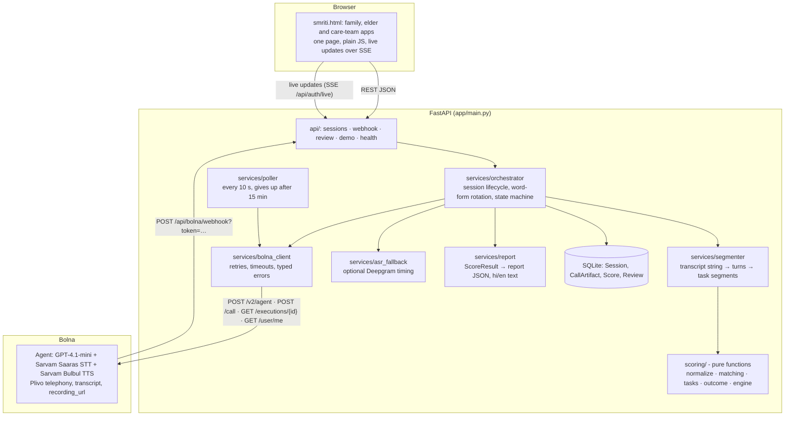
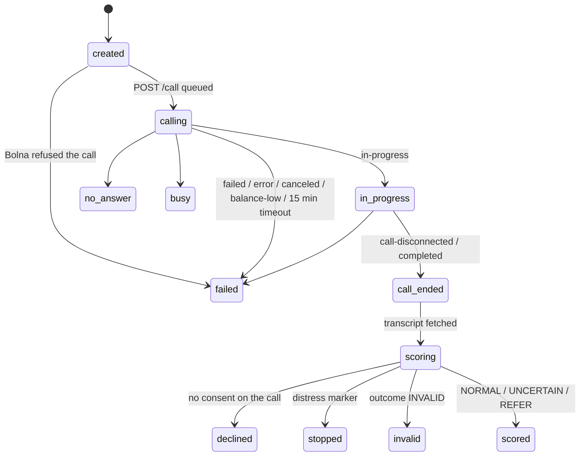

# Architecture

## Layering rules

- `scoring/` is pure Python: no I/O, no database, no network. It takes task segments + context + config and returns a `ScoreResult`. This is what most tests exercise.
- `services/` does I/O (Bolna, ASR, database) and calls `scoring/`. `app/config_loader.py` reads the YAML/JSON files once.
- `api/` is thin: validation, auth, calls into `services/`.
- Nothing in `services/` or `scoring/` imports `api/`.

## Flows

### Phone call

1. UI `POST /api/sessions {consent, language, schooling_years?, mode: "phone", phone}` → session `created`.
2. Orchestrator picks the next word form (A → B → C rotation) and calls Bolna `POST /call` with
   `user_data = {session_id, word_form, language, word_list}`. The phone number is hashed (salted) and only the last 4 digits are kept. Session → `calling`, `execution_id` saved.
3. Bolna POSTs every status change to `/api/bolna/webhook?token=…` (or, with no public URL, the poller asks every 10 s).
4. On every update the server **re-fetches** `GET /executions/{id}`; the webhook body is never trusted on its own.
5. On `completed`: parse the transcript string (`assistant: … / user: …`), split into tasks by the marker phrases, (optionally) time the animal-naming minute from the recording, score, build the report, save. Session → `scored` / `invalid` / `stopped` / `declined`.
6. The Live page polls `GET /api/sessions/{id}` (or listens on `GET /api/events?session_id=…`, below) and redirects to the Report.

### Web call (optional)

`POST /api/sessions {mode: "web"}` → the server mints a single-use session with `POST /web-call/session` (the browser never sees the API key) → `webcall.js` connects with `@bolna/web-call` → on `call-end` the browser goes to the Live page; the same webhook/poller pipeline produces the report.

### Offline demo (`DEMO_MODE=1`)

On startup the 4 fixtures are scored by the real engine and saved as `demo-normal`, `demo-uncertain`, `demo-refer`, `demo-invalid-hearing`. Starting a check simulates a call: the session walks through the same state machine (`ringing → in-progress → call-disconnected → completed`) and the chosen fixture transcript is scored. No external calls are made.

## Session state machine

Review status is a separate field: `not_needed` (NORMAL) · `pending` (UNCERTAIN / REFER / INVALID) · `reviewed`.

Bolna execution status → session status:

| Bolna | Smriti |
|---|---|
| scheduled, queued, rescheduled, prepared, initiated, ringing | `calling` |
| in-progress | `in_progress` |
| call-disconnected | `call_ended` |
| completed | `call_ended` → `scoring` → final |
| no-answer (or answered by voicemail) | `no_answer` |
| busy | `busy` |
| failed, error, canceled, balance-low, stopped | `failed` |

## Live updates and call ops

- **`GET /api/events?session_id=<id>`** is a Server-Sent Events stream for one session (no token: the session id is the key, as for its report). **`GET /api/events`** without a session id streams every session and needs the reviewer token (`Authorization: Bearer …`, or `?token=…` because a browser `EventSource` cannot send headers; the access log masks `token=`).
  Messages have no `event:` name, so `EventSource.onmessage` gets them all; `data` is JSON with a `type`:
  `snapshot` (current status, first message of a one-session stream), `session_status` (`{session_id, status, previous, review_status, is_demo}`; covers `created`, `calling`, `in_progress`, `call_ended`, `scoring` and every final status) or `session_ops` (`{session_id, status, total_cost, call_duration, time_to_first_audio}`). A `: keep-alive` comment is sent every 15 s (`SSE_KEEPALIVE_SECONDS`). Events come from the same code paths whether the change arrived by webhook, poller or demo simulation (`services/events.py`, an in-process pub/sub: with several server processes each one only sees its own changes, so run one worker for the demo).
- **Call ops** (`total_cost`, `cost_breakdown`, `latency_data` and its `time_to_first_audio`, conversation duration, `telephony_data.recording_url`, `hangup_reason`, `hangup_by`) are copied onto the session every time an execution is fetched, even after scoring (Bolna may fill the cost in late). They appear as `call_ops` in `GET /api/sessions/{id}` and in the review queue. The recording URL is only returned with the reviewer token; everyone else sees `has_recording`. Values are in Bolna's own units. In `DEMO_MODE` simulated calls store made-up numbers with `call_ops.simulated = true`.
- **`GET /api/ops/summary`** (reviewer token) returns the Bolna wallet and concurrency from `GET /user/me` (cached 60 s, `OPS_CACHE_SECONDS`; fields are `null` with an `error` if Bolna fails, and `source: "demo"` in `DEMO_MODE`), plus counts and average/total cost, duration and time-to-first-audio over the last `?limit=50` real sessions.
- **Schema changes:** there are no migrations. On startup `init_db` adds any new nullable column to an existing SQLite database (`ALTER TABLE … ADD COLUMN`), so old `smriti.db` files keep working. Deleting `smriti.db` is also safe in demo mode (samples are re-seeded).

## Webhooks during a laptop demo

Bolna can only POST to a public https URL. Without one the poller asks `GET /executions/{id}` every 10 s, which works but makes the UI lag by up to 10 s. To get instant updates while the server runs on a laptop:

1. Start the app: `uvicorn app.main:app --port 8000` (one worker).
2. Open a tunnel to it with a tool that is already installed, e.g. `cloudflared tunnel --url http://localhost:8000` (prints `https://<random>.trycloudflare.com`) or `ngrok http 8000` (prints `https://<random>.ngrok-free.app`).
3. In `.env` set `PUBLIC_BASE_URL=https://<that host>` (no trailing slash) and make sure `BOLNA_WEBHOOK_TOKEN` is a long random string, then restart the app. `GET /api/health` should now say `"webhook_reachable": true`.
4. Push the new webhook URL to the agent: `python scripts/create_agent.py --update` (add `--multilingual`, or `--language kn` / `--language en`, exactly as the agent was created; `--dry-run` first shows the `webhook_url` it will send). The URL is `PUBLIC_BASE_URL/api/bolna/webhook?token=BOLNA_WEBHOOK_TOKEN`.
5. Free tunnel hostnames change on every restart: repeat steps 3–4 each time.

What the webhook does: Bolna POSTs the execution (`id`, `status`, `transcript`, `telephony_data`, `extracted_data`, `context_details`, …). The handler checks the token, matches the session by `id` / `execution_id` (or, for web calls, `context_details.recipient_data.session_id`), returns 204 at once and then **re-fetches** `GET /executions/{id}` and runs the same `apply_execution` as the poller. Scoring is claimed atomically, so a webhook, a duplicate webhook and the poller can all arrive for the same call and it is scored once.

If the tunnel drops or the webhook is never called, nothing breaks: the poller keeps running in live mode regardless and picks the call up within `POLL_INTERVAL_SECONDS` (10 s).

## Reliability

- Bolna client: 15 s timeout, 3 retries with exponential backoff on 5xx and network errors for reads (placing a call or creating an agent is retried only on connection errors, so nobody is dialled twice), no retry on 4xx, typed errors (`BolnaAuthError`, `BolnaNotFound`, `BolnaRateLimited`, `BolnaClientError`, `BolnaServerError`, `BolnaNetworkError`).
- Final sessions ignore further updates, so a webhook and the poller firing for the same call cannot double-score.
- Logs are one JSON line per event with ids only; phone-number-like strings and transcript fields are redacted.
