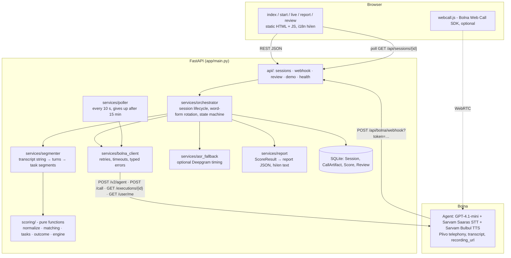
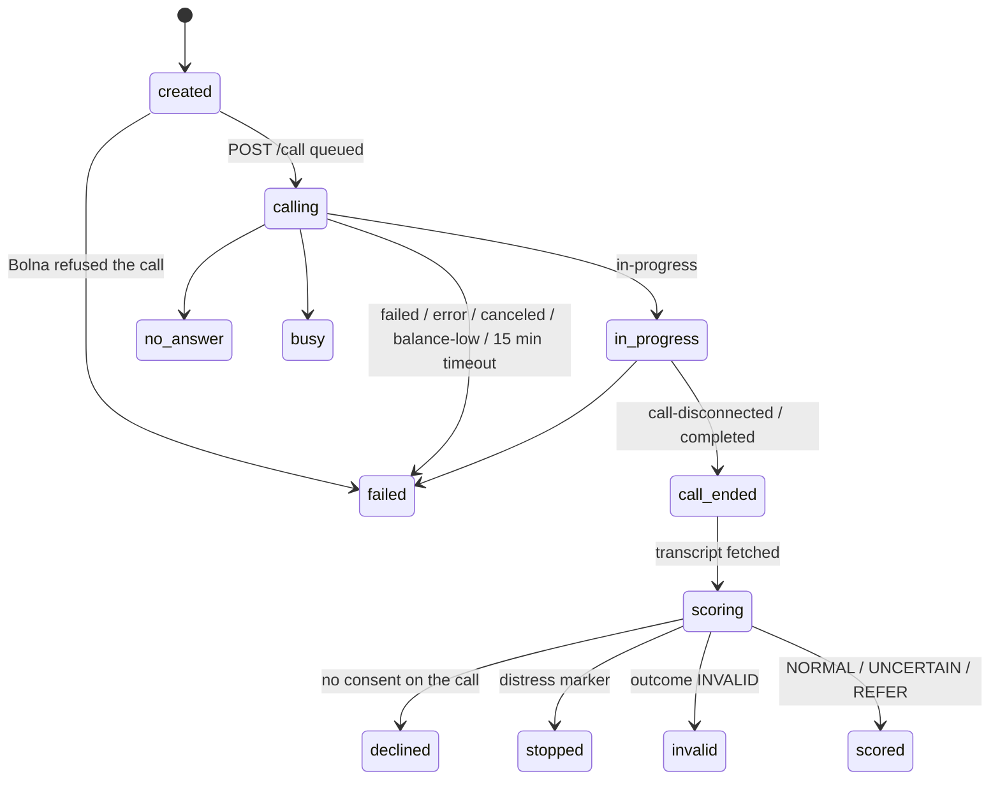

# Architecture

## Layering rules

- `scoring/` is pure Python: no I/O, no database, no network. It takes task segments + context + config and returns a `ScoreResult`. This is what most tests exercise.
- `services/` does I/O (Bolna, ASR, database) and calls `scoring/`. `app/config_loader.py` reads the YAML/JSON files once.
- `api/` is thin: validation, auth, calls into `services/`.
- Nothing in `services/` or `scoring/` imports `api/`.

## Flows

### Phone call

1. UI `POST /api/sessions {consent, language, schooling_years?, mode: "phone", phone}` → session `created`.
2. Orchestrator picks the next word form (A → B → C rotation) and calls Bolna `POST /call` with
   `user_data = {session_id, word_form, language, word_list}`. The phone number is hashed (salted) and only the last 4 digits are kept. Session → `calling`, `execution_id` saved.
3. Bolna POSTs every status change to `/api/bolna/webhook?token=…` (or, with no public URL, the poller asks every 10 s).
4. On every update the server **re-fetches** `GET /executions/{id}`; the webhook body is never trusted on its own.
5. On `completed`: parse the transcript string (`assistant: … / user: …`), split into tasks by the marker phrases, (optionally) time the animal-naming minute from the recording, score, build the report, save. Session → `scored` / `invalid` / `stopped` / `declined`.
6. The Live page polls `GET /api/sessions/{id}` and redirects to the Report.

### Web call (optional)

`POST /api/sessions {mode: "web"}` → the server mints a single-use session with `POST /web-call/session` (the browser never sees the API key) → `webcall.js` connects with `@bolna/web-call` → on `call-end` the browser goes to the Live page; the same webhook/poller pipeline produces the report.

### Offline demo (`DEMO_MODE=1`)

On startup the 4 fixtures are scored by the real engine and saved as `demo-normal`, `demo-uncertain`, `demo-refer`, `demo-invalid-hearing`. Starting a check simulates a call: the session walks through the same state machine (`ringing → in-progress → call-disconnected → completed`) and the chosen fixture transcript is scored. No external calls are made.

## Session state machine

Review status is a separate field: `not_needed` (NORMAL) · `pending` (UNCERTAIN / REFER / INVALID) · `reviewed`.

Bolna execution status → session status:

| Bolna | Smriti |
|---|---|
| scheduled, queued, rescheduled, prepared, initiated, ringing | `calling` |
| in-progress | `in_progress` |
| call-disconnected | `call_ended` |
| completed | `call_ended` → `scoring` → final |
| no-answer (or answered by voicemail) | `no_answer` |
| busy | `busy` |
| failed, error, canceled, balance-low, stopped | `failed` |

## Reliability

- Bolna client: 15 s timeout, 3 retries with exponential backoff on 5xx and network errors for reads (placing a call or creating an agent is retried only on connection errors, so nobody is dialled twice), no retry on 4xx, typed errors (`BolnaAuthError`, `BolnaNotFound`, `BolnaRateLimited`, `BolnaClientError`, `BolnaServerError`, `BolnaNetworkError`).
- Final sessions ignore further updates, so a webhook and the poller firing for the same call cannot double-score.
- Logs are one JSON line per event with ids only; phone-number-like strings and transcript fields are redacted.
